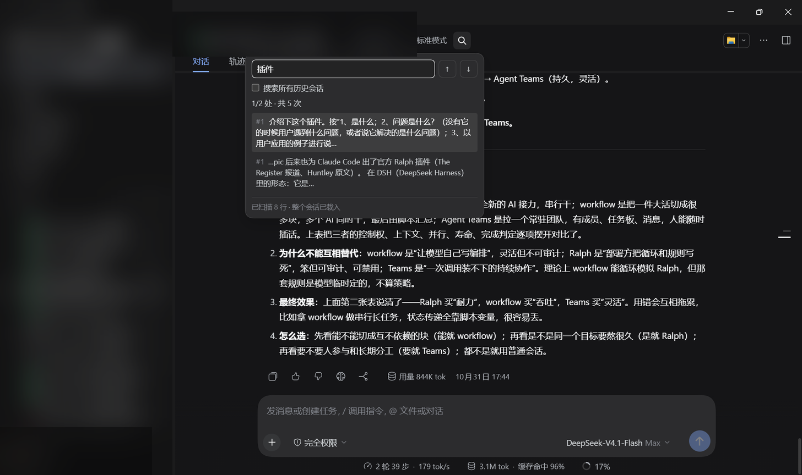
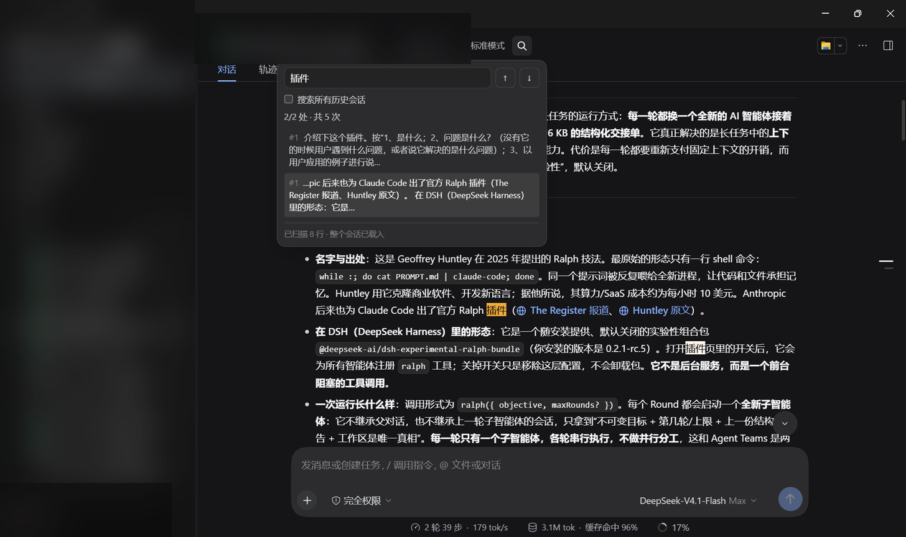
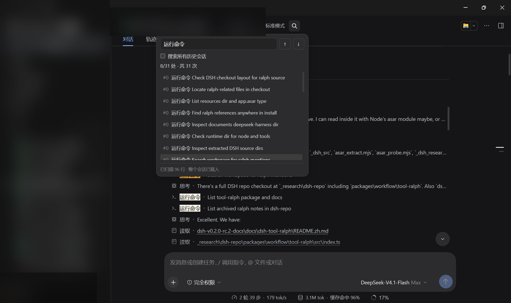

# dsh-chat-find

> 在 DeepSeek Harness 的聊天记录里找一句话——**中文不再漏词，点到哪就跳到哪**。

[](LICENSE)
[](#兼容性)

> **TL;DR (English)**: Literal-substring find for the DeepSeek Harness chat transcript. Chinese-safe (the host FTS5 tokenizer misses two-character Chinese words), pixel-accurate scroll-to-match across nested scrollports, and highlights via the CSS Custom Highlight API without touching React's DOM. 81 automated checks.

一个 DSH 客户端插件，在**当前会话**内做字面量精确查找（`Ctrl+F` 式），也支持切到**跨会话**搜索。它不修改模型请求、不碰会话日志、Host 半边是空的——只在 Web 界面的会话头部多一个放大镜。

**Trust bar**：不联网（源码无 `fetch`/`XHR`/`WebSocket`）、不写会话日志、Host 半区 `apply(){}` 空实现、只存一个 localStorage 偏好；不改模型请求、不改会话数据。



> 截图来自真实 DSH 窗口：**会话列表、用户名、会话标题已做模糊脱敏**，正文保留用于展示插件效果（内容为公开的开源技术讨论）。

---

## 为什么要做它

如果你在 DSH 里找过一句中文，大概遇到过这三种难受：

| 方式 | 问题 |
|---|---|
| 浏览器 `Ctrl+F` | 只能搜**已经渲染**的 DOM，长会话里前面几屏根本搜不到 |
| DSH 的跨会话搜索（`session.search` / FTS5 后端） | SQLite FTS5 用的是 `unicode61` 分词器，**两个汉字的词经常 0 命中** |
| 目测滚动 | 一条长回复就是几屏高，找一句话像大海捞针 |

DSH 自带的 FTS5 对中文的实测（作者的一次真实语料：219 条 / 233,784 字）：`历史`、`界面`、`功能`、`侧边栏`、`这个网页` 全部返回 **0 命中**——不是没写，是分词器不切中文。这个插件就是为了填上这个洞。

> 想用你自己的聊天记录复现这组对比？跑 `node test-chinese-recall.mjs`——它解码你本地最大的会话日志，同时对 FTS5 与本插件的匹配器跑同一组词，逐词打印 `raw / fts5-u61 / plugin` 三列（无本地数据时自动跳过）。**结果会随语料不同而变化**：某些词在另一批会话里可能 FTS5 也能命中。

---

## Top 3 亮点

### 1️⃣ 中文 0 漏词：不信分词器，直接字面量扫描

自带搜索走 FTS5 分词，本插件走**字面量 substring 扫描**：把当前已渲染的消息行取出来，用大小写不敏感的正则做真实子串匹配。中文没有词边界问题，`界面`、`功能`、`侧边栏` 想搜就搜。

同一批语料上，**测试里的 10 个词插件都能命中（FTS5 对其中若干为 0）**。注意这是"词级覆盖"——证明这些词搜得到，不证明"每一次出现都不漏"。

扫描是廉价的：单遍字面量匹配，几十万字符级的真实会话上输入即出结果、无可感知延迟；结果实时刷新（150 ms 防抖）。实际耗时取决于会话长度，可以自己用 `performance.now()` 复测。

### 2️⃣ 点到哪，跳到哪：像素级定位 + 嵌套滚动

这是这个插件最费劲的一块。DSH 的聊天记录不是"一个滚动条走到底"：

```text
[data-conversation-scroll]         ← 会话滚动容器
└─ [data-chat-anchor-key] 行        ← 「一行」= 一条消息/一个 flow 节点，长回复一行可数千像素高
   └─ [data-step-process-body]      ← 展开的工具调用分组，自带 max-height:min(400px,50vh) 内层滚动
```

两个坑叠在一起：

- 对**整行**做 `scrollIntoView({block:'center'})`，长回复会停在"整行中部"，与匹配点差几千像素；
- 只滚外层容器，会漏掉**工具调用分组的内层滚动体**，点了第 8 条结果，视口却停在分组外面。

插件的做法：拿匹配文字自己的 `Range.getBoundingClientRect()`，从内到外**逐层滚动所有滚动容器**（每滚一层重读一次矩形；多层用同步 `instant`，单层用 `smooth`），把匹配点放到容器垂直中线，并 clamp 在滚动范围内。





另外它还处理了"聊天还在流式输出"的情况：扫描结果是快照，流式渲染可能把你刚才那行的文本节点换掉（Range 失效）。点击时会按行锚点**重查 DOM 并重建 Range**，所以边聊边搜也不会跳错地方。

### 3️⃣ 高亮不破坏 React：CSS Custom Highlight API

高亮最直觉的做法是往匹配文字外包一层 `<mark>`——但这**替换了 React 自己的文本节点**。React 之后会往那个已脱离文档的节点写文字，表现为"搜索过后那段文字不再更新"，删除时还可能抛 `NotFoundError`（从 React commit 内部抛出，外部 try/catch 抓不到）。

本插件改用 **CSS Custom Highlight API**（`CSS.highlights` + `Range`）：高亮是浏览器画在 Range 上的，**完全不碰 DOM 树**。不支持该 API 的环境会降级为"只列结果、不画高亮"，并在面板底部注明。

---

## 安装

**前提**：DSH 桌面版。**Windows 已实测**；macOS/Linux 未实测——插件本身不依赖平台 API，但安装脚本是 PowerShell，非 Windows 请用方式 A 或 C。已有一个 profile（默认 `~/.dsh/profiles/desktop`，实际名字可在 DSH 设置里看到）。

> **包名说明**：`@local/dsh-chat-find` 里的 `@local/` 是 DSH 本地插件的命名空间（官方模板即如此），**不是 npm 包**。本仓库不发布 npm；`package.json` 的 `private: true` 表示"只从源码安装"。

### 方式 A：在 DSH 插件页安装本地 bundle（推荐）

这是 DSH 官方路径（对应 `plugin_manager install_bundle`，参数是插件目录的**绝对路径**）：由 DSH 自己写 profile 并启用插件，不需要手改 `package.json`。

1. `git clone https://github.com/ye001991g/dsh-chat-find.git`
2. 在 DSH 里安装这个本地 bundle：用插件页/插件市场里的"安装本地插件"入口（**不同 DSH 版本的菜单名可能不同**；官方保证的等价命令是 `plugin_manager install_bundle`，参数为 `dsh-chat-find` 目录的绝对路径）
3. 在插件列表里确认 `chat-find` 显示 **运行中**
4. 重启 DSH（首次装载需要）
5. 打开任意会话，右上角出现放大镜

### 方式 B：脚本安装（离线/批处理备选）

需要 **Node 22+** 与 PowerShell（Windows 自带 5.1 即可，不需要 `pwsh`）。脚本会优先用 DSH 自带的 Node，找不到才回退到 PATH 里的 `node`。

```powershell
git clone https://github.com/ye001991g/dsh-chat-find.git
cd dsh-chat-find
powershell -ExecutionPolicy Bypass -File .\install.ps1 install
```

- profile 不叫 `desktop` 时加参数：`-ProfileName <你的 profile 名>`。
- 脚本做两件事：① 把插件装进 profile 的 `node_modules`；② 在 profile 的 `package.json` 的 `dsh.profile.bundles` 里加一行。
- 装完**重启 DSH 一次**（首次装载；之后改插件代码走热重载）。
- 卸载：`powershell -ExecutionPolicy Bypass -File .\install.ps1 uninstall`

> ⚠️ **不要**再往 `cordis.patch.yml` 里加 `insert` 行：`dsh.profile.bundles` 的条目已经会自动应用包自带的 patch，重复挂载会让同一个 `slot id` 注册两次而报错（见 [INSTALL.md](INSTALL.md) 的 Bug 4）。

### 方式 C：完全手动（开发者/排障）

```powershell
# 1. 克隆
git clone https://github.com/ye001991g/dsh-chat-find.git

# 2. 装进 profile：pnpm 在 DSH 的 runtime 目录里，路径随版本变化，先确认存在
#    常见位置：<DSH安装目录>\resources\runtime\primary-runtime\dependencies\pnpm\bin\pnpm.mjs
#              或 ~/.dsh/dsh-runtimes/dsh-primary-runtime/dependencies/pnpm/bin/pnpm.mjs
node "<pnpm.mjs 路径>" --dir "$env:USERPROFILE\.dsh\profiles\desktop" add "file:<你的仓库绝对路径>"

# 3. 在 profile 的 package.json 的 "dsh.profile.bundles" 数组里加一行：
#    "@local/dsh-chat-find"

# 4. 重启 DSH
```

### 装完看不到放大镜？按这 4 步排查

1. **插件是"运行中"吗**：设置 → 插件，确认 `chat-find` 开关是开的（刚装完默认可能是关闭）。
2. **装进的是你正在用的 profile 吗**：多 profile 时容易装错；脚本方式用 `-ProfileName` 指定。
3. **重启过了吗**：首次装载必须重启（新客户端模块无法热加载）；之后改插件代码不需要。
4. 仍然没有：打开开发者工具，看 console 里是否有 `[chat-find]` 开头的报错。

---

## 使用

1. 打开任意会话，右上角动作区出现**放大镜**图标。
2. 点开 → 输入要查的文字（支持中文、空格分词、大小写不敏感）。
3. 结果实时列出：`N/M 处 · 共 K 次`，每条带轮次号与摘要片段。
4. `↑ / ↓` 在匹配间跳转，或直接点结果行；视口会精确停在匹配文字上。
5. 底部如实说明搜索范围：
   - `已扫描 N 行 · 更早历史未载入` → 点「载入更早」往前翻一页，翻完重扫；
   - `已扫描 N 行 · 整个会话已载入` → 已覆盖全量。
6. 勾选**搜索所有历史会话** → 切到跨会话模式（走 DSH 自带的 `session.search`）。

| 功能 | 说明 |
|---|---|
| 当前会话精确查找 | 字面量 + 中文友好，每行一个结果 + 轮次号 |
| 跨会话搜索 | 复用宿主 `session.search`；**中文可能漏词**（宿主 FTS5 限制），面板会写明 |
| 上下条跳转 | `↑/↓` 与点击结果行，像素级定位（含内层滚动体） |
| 范围提示 / 载入更早 | 明确告诉你覆盖了多少，不假装搜了全量 |
| 偏好持久化 | 「跨会话」开关记在 localStorage，下次打开沿用 |

### 对比

| | 浏览器 Ctrl+F | DSH 的跨会话搜索 | 本插件 |
|---|---|---|---|
| 中文两字词 | ✅ | ❌ 常 0 命中 | ✅ |
| 未渲染的历史 | ❌ | ✅ | ✅（载入更早后） |
| 定位到具体匹配 | 浏览器原生 | 打开会话 | ✅ 像素级 + 嵌套滚动 |
| 高亮 | 浏览器原生 | — | ✅ 不碰 DOM |
| 结果带轮次/摘要 | ❌ | ✅ 摘要 | ✅ |

---

## 它是怎么做到的（给插件开发者）

这个插件全部逻辑在客户端（`client.js`），Host 半边（`index.js`）是空的——不注册服务、不碰 RPC、不影响模型请求。几个值得参考的点：

- **注册方式**：`window.__ModuleLoader__.load({ id, factory })` + `ctx.slots.inject('conversation.session.header.actions', ...)`；`inject: ['slots', 'sessions']`（漏了 `sessions` 会报 `cannot get property "sessions" without inject`）。
- **浮层必须 portal**：会话头部的动作槽渲染在 `.titleCluster` 内；DSH 0.2.2-rc.1 实测该容器有 `overflow: clip` + 渐隐 mask（版本升级后结构可能变化），`position:absolute` 的下拉面板会被裁成一条不可见的横条。正确做法是 `ReactDOM.createPortal(panel, document.body)` + `position:fixed`，坐标由 trigger 的 `getBoundingClientRect()` 算出。
- **查找用 Range，不用 DOM 改写**：匹配高亮走 `CSS.highlights`，滚动定位走 `Range.getBoundingClientRect()`；扫描结果缓存 `{key, turn, text, firstRange}`。
- **嵌套滚动容器要逐层处理**：`[data-conversation-scroll]` 是外层，`[data-step-process-body]` 是内层（展开的工具分组）；只滚一个会"点了没反应/跳错地方"。
- **流式安全**：点击时校验 `hit.el.isConnected` 与 `Range.startContainer.isConnected`，失效则按 `data-chat-anchor-key` 重查行、重建 Range。
- **热重载**：`@deepseek-ai/dsh-client-hmr` 每 500 ms stat 轮询 client bundle，覆盖 profile 里的副本后约 2 秒自动重载，**改代码不需要重启 DSH**。

更细的踩坑记录（Bug 6/7、验证方法、HMR 机制、已知限制）见 [INSTALL.md](INSTALL.md)。

---

## 兼容性

- **DSH 0.2.2-rc.1**（Windows 实测；macOS/Linux 未实测，但插件不依赖平台 API）。
- 依赖的客户端接口：`conversation.session.header.actions` 槽、`slots` / `sessions` 服务、`ctx.uiWorkspace.openSession`。
- 高亮依赖 CSS Custom Highlight API（Chrome/Edge 105+）；不支持时自动降级为"只列结果"。

## 已知限制

- **跨会话模式的中文召回受宿主持有 FTS5 限制**（`unicode61` 分词），会漏词；面板里明确标注了。当前会话模式不受影响。
- **折叠区（`hidden="until-found"`）内的文本暂不参与扫描**——这类内容需要宿主先展开。
- 小窗口（高 ≤ 860px）下，匹配若落在行尾，可能被浮层面板遮住；建议放大窗口或先关面板。
- 结果列表上限 220px 高，超出需滚动查看。

## 开发与测试

```powershell
node test-client.mjs            # 32 项：bundle 注册 / inject 契约 / 组件渲染
node test-panel.mjs             # 20 项：面板交互 / 跨会话路径 / 错误呈现
node test-host-resolution.mjs   # 11 项：bundle patch 只插入一行
node test-scroll.mjs            # 18 项：滚动定位（单层/双层/流式失效/回退/clamp/reduced-motion）
node test-chinese-recall.mjs    # 可选：中文召回 vs 宿主 FTS5 的横向对比（读本机会话数据，无数据自动跳过）
```

合计 **81/81** 通过（前四个不依赖本机数据，任何环境可直接跑；`test-chinese-recall.mjs` 需要本机会话数据，无数据时输出 skip 并以 0 退出）。

> `test-scroll.mjs` 的 18 项在第二轮代码复核时被**变异测试**验证过：把实现故意改坏（只滚第一个容器、或点击时不重建失效的 Range），对应断言立刻失败。这保证测试钉住的是行为，而不是复述实现。

## License

[MIT](LICENSE) © 2026 ye001991g
